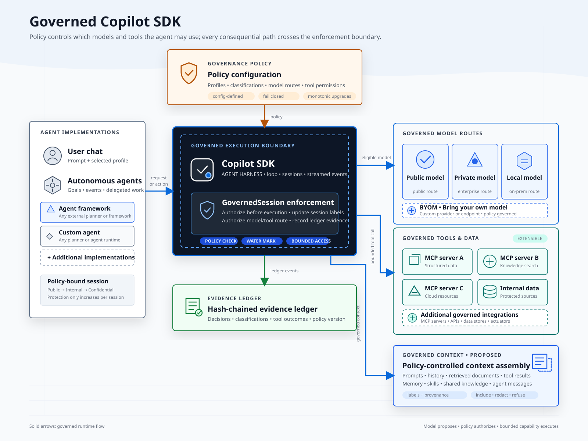
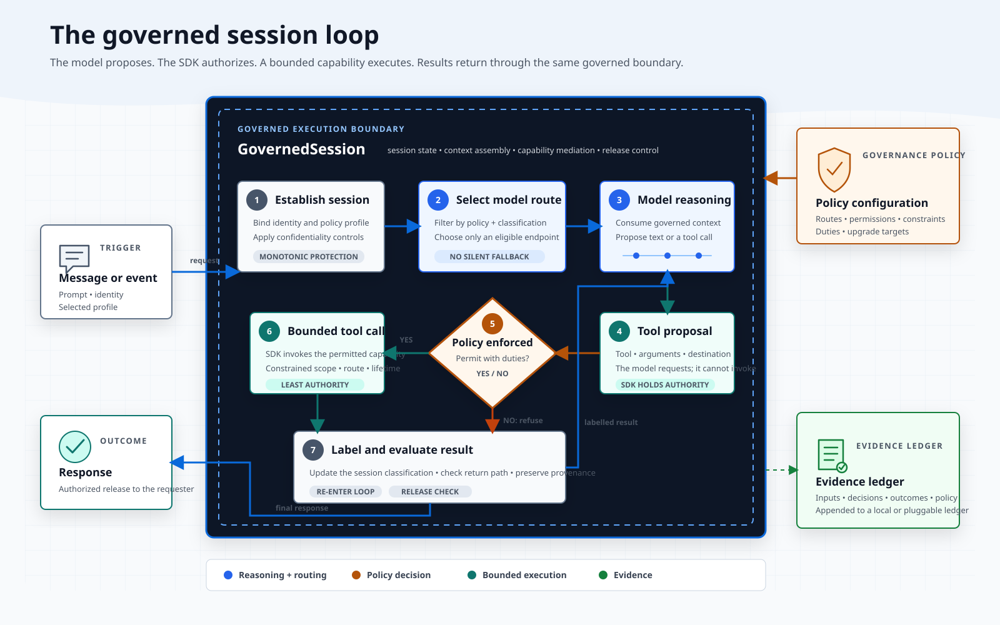

# Governed Copilot SDK

A language-oriented governance sidecar for the GitHub Copilot SDK.

The first implementation targets Node.js and uses the published `@github/copilot-sdk` package as a dependency. Governance policy and evidence-ledger behavior live above the SDK through its public hooks, permissions, model selection, MCP, and session-event APIs.



## How it works

A message enters the governed session, the SDK binds it to a policy profile and selects an eligible model, and the model proposes a response or a tool call. Every tool call is authorized against policy before it executes; labelled results can raise the session's classification, which narrows what can happen next. Every decision is appended to an evidence ledger.



## Tool search

The underlying Copilot SDK can defer MCP/external tool definitions behind a built-in `tool_search_tool` once the tool count passes a threshold, instead of loading every tool schema into every turn. `GovernedSession` always registers a governance-aware override of that tool: search results are filtered through the active profile's tool allow/deny list and `toolClassifications`, so the model never discovers a tool it isn't permitted to call. Configure it in `governance.config.json`:

```json
"toolSearch": { "enabled": true, "deferThreshold": 30 }
```

[test/toolSearchTokenSavings.test.mjs](nodejs/test/toolSearchTokenSavings.test.mjs) estimates the upfront prompt-size impact (chars/4 ≈ tokens heuristic) as the tool count grows: negligible below the defer threshold, ~75% smaller at 60 tools, ~95% smaller at 300 tools, since only the deferred-but-matched tools' schemas are sent instead of the full catalog.

See [docs/tool-search.md](docs/tool-search.md) for the full design, and [`nodejs/samples/mcps/catalog-demo-mcp-server.mjs`](nodejs/samples/mcps/catalog-demo-mcp-server.mjs) for a 35-tool synthetic catalog wired into the sample config to see deferral and governance-filtered search engage live.

## Prerequisites

- Node.js 22 or later.
- GitHub Copilot CLI installed and authenticated with an account that has Copilot access.

Run `copilot --version` and `copilot` before starting the sample if authentication has not already been completed.

## Get started

```powershell
cd nodejs
npm install
npm run build
npm install --prefix samples\governed-chat
npm start -- --config=samples/sample.governance.config.json --info
```

The chat starts in the `public` profile. It loads [nodejs/samples/sample.governance.config.json](nodejs/samples/sample.governance.config.json), starts the configured `internal-data` MCP server, and writes Copilot state plus hash-chained governance evidence under `nodejs/samples/.copilot-state`.

For Azure Foundry configurations, copy [nodejs/samples/.env.sample](nodejs/samples/.env.sample) to `nodejs/samples/.env` and provide the required values. Do not commit that file.

## Guided chat example

Paste this into governed chat:

```text
Search internal documents for the Northwind escalation. Then use web search to find recent competitor authentication-reliability announcements and draft customer talking points using the escalation details.
```

The synthetic MCP result includes a customer escalation and an embargoed product announcement, labelled `confidential`. Governance upgrades the chat with `reason=classified-tool-result`. The `confidential` profile allows the internal-data MCP tools but not `builtin:web_search`, so an attempted public research handoff is denied before execution. Start a new chat session after changing MCP configuration or policy.

See [nodejs/samples/governed-chat/README.md](nodejs/samples/governed-chat/README.md) for console options and [nodejs/samples/governed-chat-server/README.md](nodejs/samples/governed-chat-server/README.md) for the HTTP/SSE sample.

## Layout

- `nodejs/` - Node.js implementation and package.
- `docs/` - shared design and usage documentation.

Rust is intentionally not part of the first implementation. A shared Rust core can be evaluated later if multiple language bindings require identical policy semantics.
